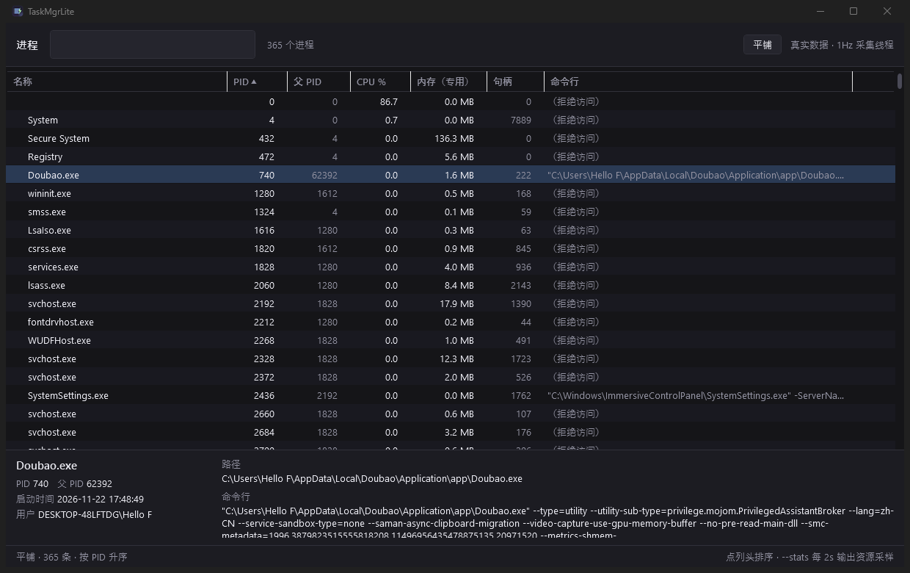
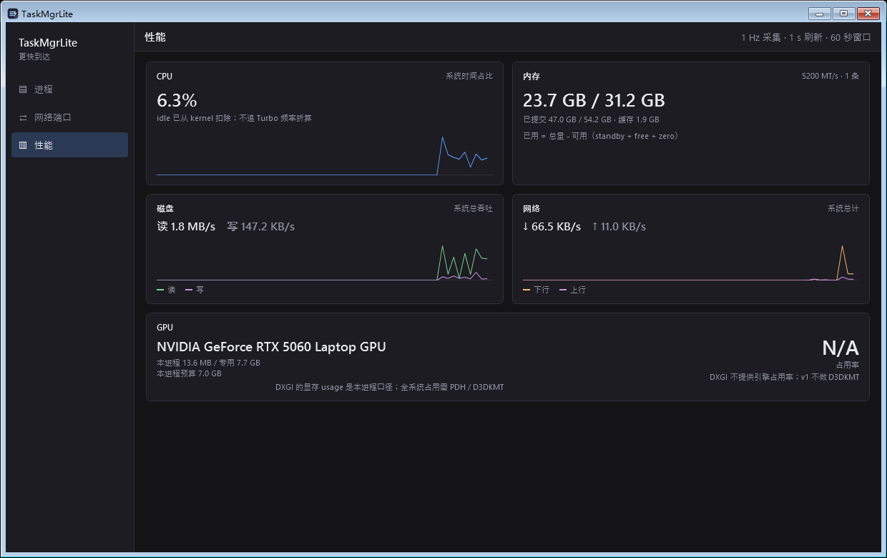

# TaskMgrLite

[](https://github.com/jf200s/TaskMgrLite/actions/workflows/ci.yml)

> 当前版本 **0.1.05** · [Release](https://github.com/jf200s/TaskMgrLite/releases/tag/v0.1.05) · [Changelog](CHANGELOG.md)

一个为“更快到达”而做的 Windows 任务管理器替代品。不是信息更多，而是启动更快、操作路径更短、底层解析更干净。



## 硬核特性

- **原生解析，不走 WMI / PerformanceCounter**：一次 `NtQuerySystemInformation(SystemProcessInformation)` 拿全量进程，unsafe 偏移直读，零分配解析。
- **极速启动**：自包含 ReadyToRun 发布，不压缩单文件；0.1.x 本机 10 次实测中位 **813ms**。
- **极低分配**：1Hz 采集稳态 `[enum]` 分配多数为 0，进程视图 125 秒长跑统计均值 **0.14MB/s**；性能页激活时总体约 **0.20–0.24MB/s**，切走后回到 **0.08–0.09MB/s**，性能采集器本身稳态 **0 B/次**。
- **300+ 进程可用**：树形结构在采集侧建 parent→children 索引，UI 侧 O(n) 展平为可见行，交给 ListView 虚拟化。
- **不可变快照 + 原子交换**：采集线程只生产不可变数组，UI 无锁读取；UI 忙时覆盖式丢弃旧快照，不排队。
- **命令行懒加载**：只在行进入可视区或选中时走 `OpenProcess + NtQueryInformationProcess(60)`，LRU 512；`AccessDenied` / `Error` 失败缓存 30 秒后自动重试。
- **详情面板**：选中行才读取全路径、用户名、命令行；启动时间/PID 等直接来自快照，不重新枚举。
- **独立网络端口视图**：左侧导航切换全系统 TCP/UDP（IPv4/IPv6），2Hz 后台轮询、按 Key Diff、搜索/排序、进程名反查、完整虚拟化；不在 1Hz 采集路径，切出立即停止。
- **独立性能视图**：左侧导航切换 CPU、物理内存、系统磁盘/网络吞吐、GPU 显存与引擎占用率；全部走原生 API，60 秒环形历史 + 原生 `Polyline` 折线，1Hz 采集/刷新，切走立即停止采集线程。GPU 部分走 DXCore：全系统专用显存 + 各引擎取最大值的占用率（与任务管理器同口径），不引入 PDH/WMI。
- **完整右键菜单**：打开文件所在位置、复制 PID、复制路径、结束进程、结束进程树；空白处右键刷新。
- **树杀按快照 DFS 后序**：后代先于祖先，逐个报告成功/失败；PID 复用用创建时间校验。
- **排序可保留**：数值列首次点击降序、名称升序；命令行列不支持排序；树形下排序挂起、箭头变暗，切回平铺恢复。批量替换后仍保持选中行。
- **树形键盘**：Left 折叠、Right 展开，不引入 TreeView。
- **提权状态恢复**：提权重启前保存搜索词、折叠集合、视图模式和列排序，新进程恢复。
- **Windows 11 外观**：DWM 圆角 + Mica（90% 暗色罩层），失败自动回退纯暗色；交替行背景提升长列表可读性。
- **无依赖自检**：`--selftest` 覆盖树、折叠、排序状态、端口 Diff、快照所有权、越界解析、缓冲区增长、批量 Reset、假数据隔离等 **72 个用例**。

## 性能视图预览



## 系统要求

- Windows 10 / 11，x64。
- 不需要安装 .NET：发布包是自包含的。
- 普通权限即可启动；读取/结束受保护进程时会提示提权重启。
- Windows 10 没有 Mica，会自动使用纯暗色窗口。

## 快速开始

从 [GitHub Releases](https://github.com/jf200s/TaskMgrLite/releases/latest) 下载并解压后直接运行：

```powershell
TaskMgrLite.exe
```

双击 exe 即可，默认使用真实进程数据。

建议创建一个快捷方式指向它（不需要任何参数）：

```text
D:\path\to\TaskMgrLite.exe
```

假数据压测模式（400 行，用于 UI 压测）需要显式加 `--fake`。

## 命令行参数

| 参数 | 作用 |
|---|---|
| `--real` | 使用真实进程数据（默认行为，保留以兼容旧快捷方式和脚本） |
| `--fake` | 假数据压测模式（400 行），不与 `--real` 同时使用时生效 |
| `--stats` | 每 2 秒输出专用工作集/工作集/私有提交/GC/句柄/分配速率 |
| `--selftest` | 不创建窗口，运行纯逻辑自检并返回退出码 |
| `--diag-round3` | 真实内核路径诊断：读命令行、PID 复用保护、单杀/受控进程树杀 |
| `--diag-round4` | 真实路径/用户名读取、Explorer 参数校验、手动刷新唤醒 |
| `--diag-perf` | 原生结构布局、首/次帧契约、稳态零分配、SMBIOS/DXCore 降级检查 |
| `--probe-exit` | 启动 3 秒后自动退出，用于启动测量 |

示例：

```powershell
.\TaskMgrLite.exe --stats
.\TaskMgrLite.exe --fake
.\TaskMgrLite.exe --selftest
.\TaskMgrLite.exe --diag-round3
.\TaskMgrLite.exe --diag-round4
.\TaskMgrLite.exe --diag-perf
```

## 使用说明

- **搜索**：顶部搜索框按进程名或 PID 过滤，150ms 防抖；搜索时自动切平铺。
- **树形 / 平铺**：右上角按钮显示下一步动作（切到平铺 / 切到树形）。树形下点 ▾ / ▸ 展开或折叠；选中行后按 Left 折叠、Right 展开。
- **排序**：数值列（PID、CPU、内存、句柄等）首次点击降序，名称升序；列头 ▲/▼ 使用 Accent 色。树形下箭头变暗表示排序挂起，切回平铺恢复。命令行是懒加载，不支持排序，点击会提示。
- **详情面板**：选中任意行，底部显示名称、PID、父 PID、启动时间、用户名、完整路径和命令行。
- **网络端口**：左侧导航切到“网络端口”，全系统列表每 500ms 刷新；按协议、地址、状态、PID、进程名搜索，点列头排序。切回“进程”立即停止轮询，进程列表保持原样；普通权限失败显示“无权限读取”。
- **性能**：左侧导航切到“性能”，CPU/内存/磁盘/网络/GPU 原生指标 1Hz 刷新；折线显示最近 60 秒，窗口高度不足时可滚动。切走后采集线程立即停止。
- **右键行**：打开文件所在位置、复制 PID、复制路径、结束进程、结束进程树。
- **右键空白处 / 表头**：只有“刷新”，立即唤醒采集线程采一次，不改变 1Hz 节拍。
- **结束进程结果**：右下角非阻塞 Toast；失败可点“详情”，拒绝访问时出现“提权重启”。Toast 8 秒自动隐藏。
- **权限不足**：Toast 里的“提权重启”会用 `runas` 重启，并恢复搜索词、折叠集合、视图模式和列排序；也可以直接右键 exe 选择“以管理员身份运行”。

## 性能基线（0.1.x 本机实测）

Windows 11 / .NET 11.0.100，2026-11-22：

- 启动 10 次：822 / 845 / 811 / 793 / 815 / 790 / 825 / 815 / 796 / 797ms，中位 **813ms**（min 790 / max 845）。
  - 未达到 800ms 的内部目标；原锁定口径 <1500ms 通过。
- 125 秒真实长跑（约 360–400 个进程，未选中详情）：
  - 专用工作集：min 47.9 / mean 62.3 / max **69.1MB**（<80MB）
  - 工作集 max 164.7MB；私有提交 max 101.8MB
  - GC：Gen0=2，Gen1=1，Gen2=0
  - 句柄：737–751
  - 托管堆：5.8–20.3MB
  - 统计分配：mean 0.14MB/s，max 1.63MB/s
  - `[enum]` 155 次：mean 0.4KB/次，max 62KB/次，min 0

进程数比 Round 4 基线少（约 360–400 vs 440），内存数字不宜直接横向比较。这些数字是 0.1.01 发布包的实际采样结果，不把“日志前的 0KB”当作整轮零分配。Gen2=0、125 秒内未破 80MB，目前按无泄漏处理。

## 架构一句话

```
NtQuerySystemInformation(class 5) → 零分配 unsafe 解析
        → 不可变快照 + 原子交换
        → 稳定 ProcKey（PID + 创建时间）
        → O(n) 树展平 + ListView 虚拟化
        → 懒加载命令行 / 路径 / 用户名
```

关键取舍：

- 不用 WPF TreeView：虚拟化不可用，改用扁平可见行。
- 排序即平铺：避免“按 CPU 排序后父子不相邻”的界面歧义。
- 命令行/详情只在需要时读，LRU 缓存；采集热路径不碰 OpenProcess。
- 树杀按点击时的快照执行，之后新出生的后代不在本轮计划内。

## 构建、测试、发布

```powershell
# 日常构建 + 自包含 R2R 发布到 publish\
.\scripts\build.ps1

# 自检 + diag + 启动测量
.\scripts\check.ps1 -StartupRuns 10

# 加上树形/平铺选中与右键菜单 UI 自动化
.\scripts\check.ps1 -Ui -StartupRuns 3

# 干净发布包：dist\TaskMgrLite-win-x64\ + zip + SHA256
.\scripts\release.ps1 -Version 0.1.01 -Ui
```

`release.ps1` 会清空 staging、重新 publish、跑 selftest 与 diag、可选跑 UI 回归，删除 PDB/XML/logs，复制 README、docs 和 .NET 声明，再生成 zip 与 `.sha256`。

## 开发规范

文件规模硬上限和“存量只能变小”的基线规则见 [docs/CODE_STANDARDS.md](docs/CODE_STANDARDS.md)。`scripts/check.ps1` 第一步和 CI 都会执行 `scripts/check-file-size.ps1`。

## 已知限制

- 发布包解压后约 137MB（自包含 WPF 运行时），zip 约 60MB；没有安装器，不是单文件，目的是保住冷启动。
- 二进制未签名，首次运行可能触发 Windows SmartScreen。
- Mica/圆角只在 Windows 11 生效；Windows 10 自动回退纯暗色。
- 受保护进程（PPL/系统进程）即使提权也可能无法读取路径或结束。
- 800ms 启动目标未达成，当前 0.1.x 中位 813ms；不为了 13ms 引入复杂懒加载。
- 树杀只覆盖点击时快照；点击后新出生的后代需要下一轮手动处理。
- 列排序不是实时排序：内存/CPU 每秒变化后，需要重新点列头或切换模式才会重排；列头箭头只表示当前排序条件。
- 命令行是懒加载的，不支持排序；点击“命令行”列头会提示，列头本身也做了弱化处理。
- 网络端口只在视图激活时按 2Hz 轮询；只覆盖 TCP/UDP（无 RAW/ICMP），UDP 远程地址和状态显示“—”；端口表只有 PID，PID 复用期间进程名可能短暂错位。

## 许可证

Copyright 2026 jf200s

本项目采用 [Apache License 2.0](LICENSE) 授权，完整条款见仓库根目录的 `LICENSE`。

发布包内含 .NET 运行时（自包含部署），其许可条款与第三方声明随包附带，见解压目录下的
`LICENSE.txt`（Microsoft .NET Library 许可）和 `ThirdPartyNotices.txt`。

